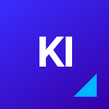
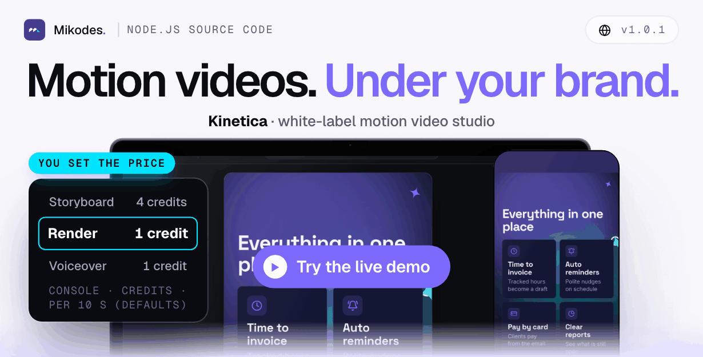
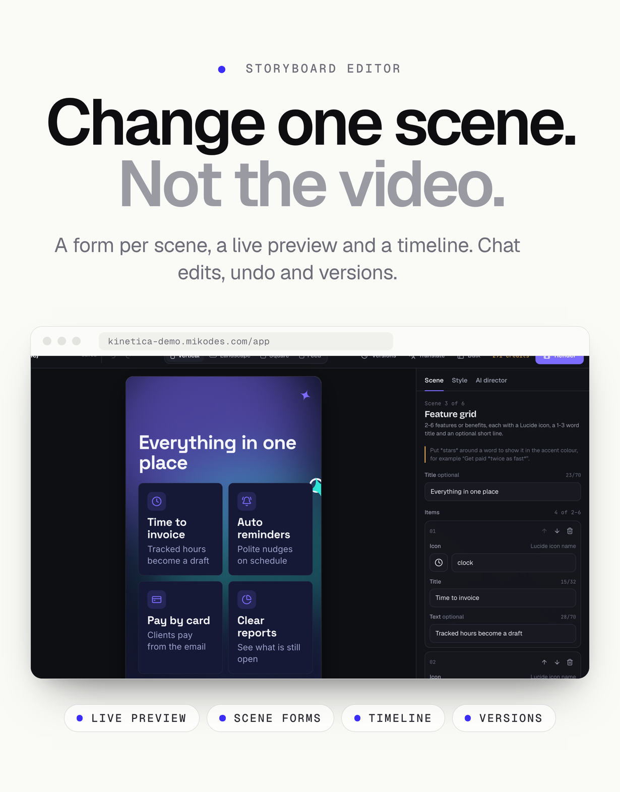
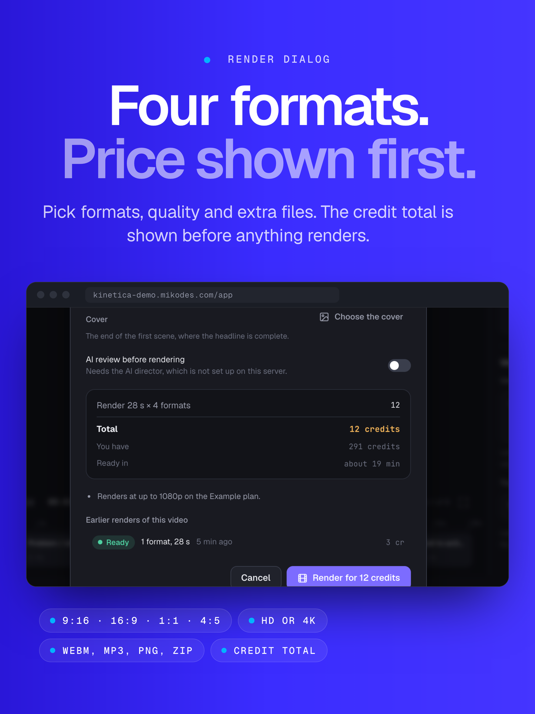
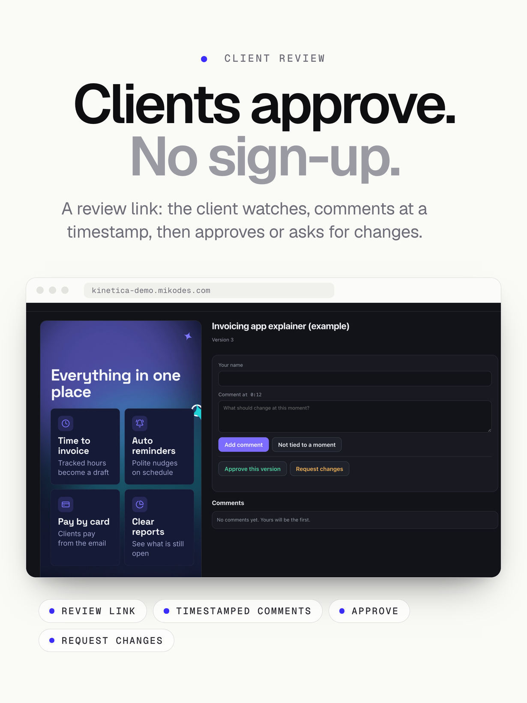
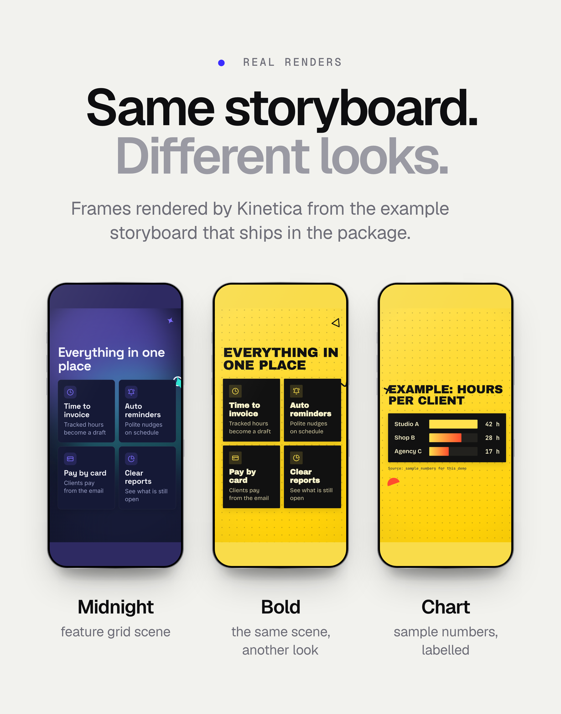
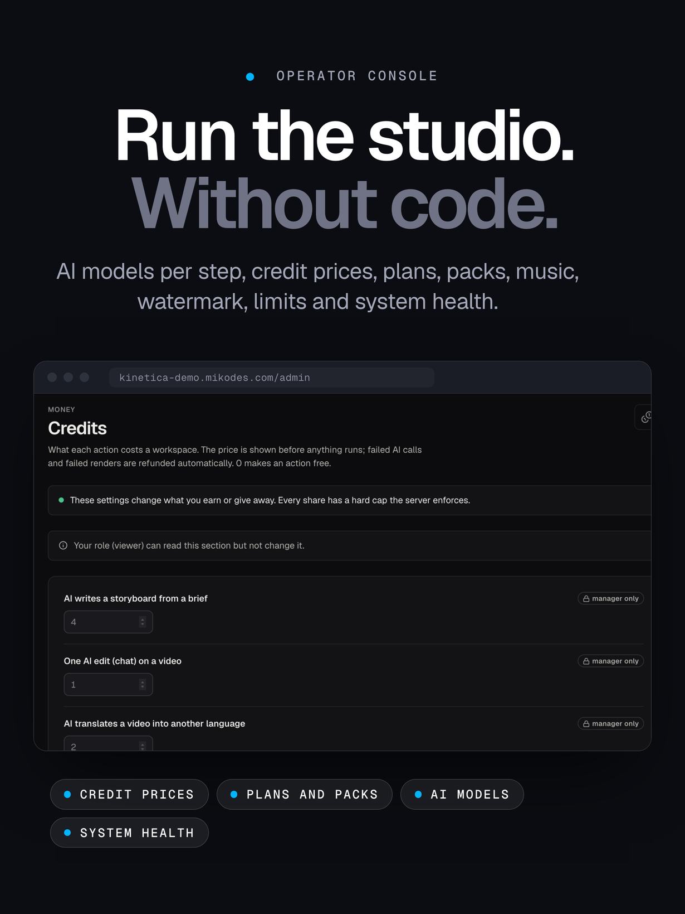

  

<h1 align="center">Kinetica</h1>

  <b>AI motion-graphics video studio, self-hosted and white-label.</b>

  <a href="https://kinetica-demo.mikodes.com/"><b>▶ Live demo</b></a> ·
  <a href="https://kinetica.mikodes.com/docs/"><b>Docs</b></a> ·
  <a href="https://kinetica.mikodes.com/"><b>Website</b></a> ·
  <a href="https://store.mikodes.com/p/kinetica/"><b>Get the full source code</b></a>

  
  
  

  

> **This repository is a showcase.** It holds screenshots, documentation pointers and a real excerpt
> from the code. The full application is sold as source code at
> **[store.mikodes.com/p/kinetica](https://store.mikodes.com/p/kinetica/)**: one payment, instant ZIP download, free setup help.

---

## What it is

A brief becomes an animated video with kinetic type, charts, icons, scene templates, voiceover, word-synced captions and sound, in 16:9, 9:16, 1:1 and 4:5, rendered on your own server.

## Screens

 

 

## Features

- **Own deterministic renderer**: No per-second video-model fees and no GSAP/Remotion licence.
- **42 scene templates**: Hook, kinetic type, charts, stats, compare, device, pricing, FAQ, countdown, before/after, testimonials.
- **18 themes with motion personalities, 13 transitions**: Same storyboard reads luxury, bold or editorial.
- **17 niche packs**: Themes, flows, tone, facts to ask for and starter prompts for SaaS, e-commerce, restaurant, real estate, fitness, education and 11 more.
- **Multi-format output**: Re-laid out per format in one render.
- **Captions: 9 styles incl. karaoke/bold/neon/typewriter, SRT + VTT**: Social-ready captions with font, colour, highlight, size, position options.
- **Music library, SFX and beat snapping**: Mixed sound bed.
- **Storyboard editor with per-scene forms, chat edit, undo, versions**: Change one scene without regenerating the whole video.
- **Brief from a website URL**: Turn a product page or blog post into a video brief with its images.
- **Brand kits with brand lock and do/don't rules, logo colour suggestion**: Agencies keep each client on brand.
- **Templates and CSV bulk**: Catalogue, menu-board and per-branch videos at scale.
- **Exports: MP4, 4K**: Deliverables for every channel in one place.

## How it works

A technical case study of the architecture, one end-to-end flow, the key engineering decisions and how you would build something like this: **[docs/HOW-IT-WORKS.md](docs/HOW-IT-WORKS.md)**.

## A look at the code

Real excerpts from the source, shown for illustration:

- **Voice- and beat-aware scene timing** ([`snippets/timeline.ts`](snippets/timeline.ts)): Scene lengths come from the voiceover word timings or from reading speed, and can snap to the music beat without drifting off the frame grid. It is why edits stay in sync when one scene is changed.
- **Fetching a website for a brief, without opening the network** ([`snippets/url_safety_guard.ts`](snippets/url_safety_guard.ts)): Before the server fetches a page a user names, it refuses private, loopback and metadata addresses (including IPv4 hidden inside IPv6), local-looking names, unusual ports and credentials in the URL.
- **Credits charged and refunded exactly once** ([`snippets/credit_refund_run.ts`](snippets/credit_refund_run.ts)): An AI storyboard run charges credits and marks the video in one transaction. Each end of the run is a conditional update, so a failure refunds once and a late answer is ignored.

## Requirements (full version)

- Node.js 26 LTS or newer
- Google Chrome or Chromium on the server
- ffmpeg
- VPS: 2 CPU cores / 4 GB RAM per render
- Domain + https reverse proxy
- ADMIN_SECRET_KEY

Not included: Hosting, VPS and domain; Anthropic API usage; ElevenLabs API usage; Stripe fees, Resend and Pexels accounts; No generative video model.

## Get the full source code

  

One payment, full licence, instant ZIP download and free setup help.
Questions: [mikodes.com/support](https://mikodes.com/support).

---

  Made by <a href="https://mikodes.com"><b>MIKODES</b></a> · <a href="https://github.com/Mikodesteam">more projects</a>

