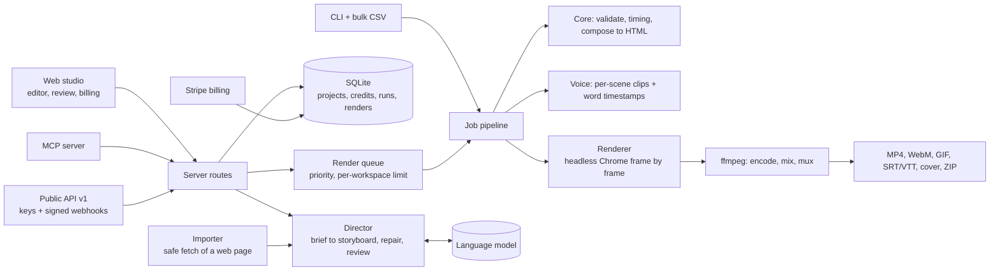

# How Kinetica works

An engineering write-up of Kinetica, a white-label studio that turns a short brief (or a web page, or a CSV row) into a finished, captioned, voiced video. It describes what the code does and why. The full source is sold separately (link at the end); only a few excerpts are public.

## Reading order

If you only have five minutes, read "Key engineering decisions", then the three excerpts in [`../snippets/`](../snippets/): [`timeline.ts`](../snippets/timeline.ts), [`url_safety_guard.ts`](../snippets/url_safety_guard.ts) and [`credit_refund_run.ts`](../snippets/credit_refund_run.ts). None is a working module on its own.

## The problem and who it is for

Making a short explainer or social video normally means a timeline editor, a voiceover and a lot of manual cutting. Kinetica treats a video as data: a typed storyboard of scenes with text, a theme and a narration. An AI director writes the storyboard from a brief, a deterministic renderer turns it into pixels, and the user can edit any scene and render again without the whole video changing. It is for agencies and operators who want to run their own video-generation service (accounts, credits, plans, client review), and for developers who want to see how to keep an AI-in-the-loop renderer predictable.

## Architecture

A TypeScript monorepo: a core library (storyboard types, scenes, themes, timing, captions), a director (AI planning and review), a renderer (browser plus ffmpeg), a server (accounts, jobs, billing, API) and a React web app. A CLI and an MCP server sit on the same packages.

Key ideas in that picture:

- The **storyboard** is the single source of truth. It is validated against a schema, and every other stage reads it.
- The **renderer is the product's own**: it composes the storyboard into one HTML page, serves it from a local server bound to the loopback address, seeks the page to each frame in headless Chrome and pipes the frames to ffmpeg. Frames are split across several pages and joined without re-encoding loss.
- **Everything the job produces is written into a job folder**, so a failed job can resume and an edit re-renders only what changed (voice clips are cached per scene text).

## One flow, step by step: a brief becomes a finished video

1. **Brief.** The user types a brief, pastes a long text, or gives a web address. For an address, the importer fetches the page through a hardened fetcher first (see decision 3).
2. **Charge and mark.** Starting an AI run charges credits and marks the project "planning" in a single transaction; a retry is only allowed from the "failed" state, so two clicks cannot start two runs (see [`../snippets/credit_refund_run.ts`](../snippets/credit_refund_run.ts)).
3. **Plan.** The director asks the language model for a storyboard in a structured format. If the result does not validate, the validation errors are sent back and the model repairs it, up to two repairs; after that the run fails.
4. **Voice.** If a voiceover is on, each scene's narration is synthesised separately (cached by text) and comes back with word timestamps. A pronunciation map changes only the text sent to the voice; captions keep the written word.
5. **Timing.** `planTiming` computes how long each scene lasts: from the spoken words when there is a voice, from reading speed when there is not, and snapped to whole beats of the music tempo when one is set (see [`../snippets/timeline.ts`](../snippets/timeline.ts)).
6. **Compose.** The storyboard and timing are composed into one HTML page. Every scene is a template from a library, styled by a theme with its own motion personality.
7. **Measure and review.** A layout check measures real overflow and overlap at the end of each scene. A contact sheet of those frames goes to the model for a visual review pass; if it proposes fixes the storyboard changes, the page is rebuilt and the layout is measured again.
8. **Render and mix.** Frames are rendered in parallel and encoded; the audio (voice clips at their scene offsets, optional music at a lower level under a voice, soft whooshes on the cuts) is mixed and muxed in.
9. **Deliverables.** Optionally the same storyboard is rendered again in other aspect ratios, and subtitles (SRT and VTT), a cover image, a GIF, a WebM copy, scene stills, the voiceover as MP3 and a ZIP are produced.
10. **Finish or refund.** The run ends exactly once: done, or failed with its credits refunded. A run that the process lost (restart, a model that never answers) is failed and refunded by a recovery routine, with a timeout of twenty minutes.

## Key engineering decisions

### 1. A typed storyboard between the AI and the renderer

*Chosen:* the model never produces pixels or code. It produces a storyboard that is validated against a schema (scene types, props, theme, format, captions, transitions), and a repair loop feeds validation errors back to it. *Alternative:* let the model write HTML or animation code. *Why:* a storyboard can be validated, versioned, edited with per-scene forms, translated, and re-rendered identically. The same document drives the editor, the CLI, the bulk CSV mode and the API.

### 2. A deterministic, own renderer instead of real-time capture

*Chosen:* the composed page is driven by a runtime that the renderer seeks to an exact time before each frame is taken, so the picture at a given frame does not depend on how fast the machine ran. *Alternative:* screen-record a playing page. *Why:* real-time capture drops frames under load and is not repeatable; seeking is slower on paper but identical on every run, which is what makes "change one scene, render again" safe, and what lets a render queue estimate durations.

### 3. Timing from audio, snapped to a grid

*Chosen:* scene length comes from the real voice duration plus a short lead and tail; without a voice from words per second of reading; with a tempo, from beats counted cumulatively and then converted to 30 fps frame times. *Alternative:* fixed scene lengths. *Why:* cumulative beat counting means rounding never accumulates drift, so the edit stays on the music and on the frame grid when one scene changes.

### 4. The server fetches pages, so it must not become a proxy into the network

*Chosen:* the importer resolves the host itself, refuses every address that is not on the public internet, then connects to exactly the address it checked, so a second DNS answer cannot redirect it (see [`../snippets/url_safety_guard.ts`](../snippets/url_safety_guard.ts)). Redirects are followed at most four times and each hop is checked again; there are limits on size and total time. *Alternative:* a hostname check or a library default. *Why:* "fetch this URL for me" is the classic way to reach cloud metadata and internal services.

### 5. Credits as a ledger with exactly-once endings

*Chosen:* credits are debited when a run starts and each run ends through a conditional update (`WHERE status = 'running'`), so only one of "done", "failed and refunded", or "timed out" can win. *Alternative:* charge on success. *Why:* AI runs cost real money even when they fail, so the charge must happen first; but the user must never lose credits to a crash, and a late model answer must not overwrite a refunded run.

### 6. One queue, two limits

*Chosen:* a render queue with plan-based priority and a limit on running renders per workspace (one by default, configurable up to eight); the Renders page shows an estimated position and start time, computed by simulating the queue with measured render speed. *Alternative:* first-come, first-served. *Why:* one busy workspace should not starve the others, and an honest estimate is better than a spinner.

## Security and safety measures that exist in the code

- **SSRF-safe import:** scheme, port and credentials checks; local-looking names refused; IPv4, IPv6, IPv4-mapped and NAT64 ranges checked; connection pinned to the checked address; bounded redirects, bytes and time.
- **Upload sniffing:** uploads (images, music, MP4) are checked against their real content by magic bytes, not by file name or declared type; an SVG that contains scripts, event handlers or script URLs is refused; served files carry a strict content security policy.
- **Signed webhooks:** outgoing events carry a timestamp and an HMAC-SHA256 signature over the timestamp and the body, with a verification helper that rejects old timestamps (five minutes by default).
- **Signed file links:** download links are HMAC-signed with an expiry, and compared in constant time.
- **Stripe:** plan subscriptions, credit packs, a customer portal and a webhook whose signature is verified before anything is trusted; revenue shown to the operator counts only Stripe-confirmed payments.
- **Per-workspace API keys** and a role model for teams; account export and delete.
- **Review links** for clients with timestamped comments, approval and change requests, kept separate from public share links.
- **Read-only demo mode** that seeds one account and refuses writes; it only starts with a password of at least eight characters.
- **Backup, restore and upgrade-check scripts** with a schema version guard.
- **Renderer bound to loopback only,** font serving restricted to font packages, and path checks that keep static file serving inside its root.
- **4K must be real:** if a 4K job comes back smaller than requested, the job fails (and refunds) instead of delivering HD.

## Details worth a closer look

### Numbers fixed in code

| What | Value | Where |
|---|---|---|
| Frame rate used for cuts | 30 fps | Timing |
| Silence before a scene's first word / breath after the last | 0.25 s / 0.45 s | Timing |
| Reading speed without a voice | 2.7 words per second, scene capped at 7 s | Timing |
| Sound effect lead before a visual hit | 2 frames | Timing |
| Storyboard repair attempts | up to 2 | Director |
| Importer redirects, page size, time | 4, 2 MB, 10 s by default | Importer |
| Allowed import ports | 80, 443, 8080, 8443 | Importer |
| Plan run timeout | 20 minutes | Credits and runs |
| Webhook timestamp tolerance | 5 minutes | Public API |
| Music level under a voice / alone | 0.22 / 0.5 | Audio mix |

### Resuming and re-rendering

The job pipeline reuses a storyboard that is already in the job folder, which is how edits and retries work: the editor saves a new storyboard and the pipeline starts from step three. Voice clips are cached per scene text, so changing one line re-synthesises one clip. Extra formats (16:9, 9:16, 1:1, 4:5) reuse the same timing and the same soundtrack and are laid out and measured again for their own frame, because a layout that fits in landscape can overflow in portrait.

### The layout check is a measurement, not an opinion

Before the model reviews anything, the page is measured at the end of each scene for overflow and overlap, and the count of issues is part of the result. The model's visual review is an extra pass on top of numbers, not a replacement for them, and it can only change the storyboard, never the renderer.

### Why pronunciation rules touch the voice only

Brand names are read wrongly by most voices, so the director accepts free-text notes ("name sounds like ...") and turns them into rules. The rules rewrite only the text sent to the voice engine, so a caption still shows the correct spelling. Notes that do not read as "written form, spoken form" are skipped rather than guessed at.

### Bulk mode

A CSV (comma or semicolon separated, because spreadsheets in many locales save with semicolons) is parsed into rows and filled into a storyboard template with `{{column}}` placeholders. A cell that is only a number stays a number, and fields left empty drop out of the storyboard instead of rendering as blank text.

## How you would build something like this

1. **Define the document first.** Write the storyboard schema and a validator that returns precise error paths. Everything else depends on it, including the AI repair loop.
2. **Make one scene render from time alone.** Build a single scene template whose output depends only on `t`. Then build the seek-and-screenshot loop, pipe frames to ffmpeg and get a one-scene MP4 out.
3. **Add timing as its own pure function** (voice words in, scene start and end times out) and unit test it, including the beat-snapping case.
4. **Bring in the AI only after the pipeline is deterministic.** Ask for the schema, validate, send errors back, cap the repairs. Then add the visual review: measure layout issues numerically, show the model a contact sheet, and re-measure after it changes anything.
5. **Add voice with caching and word timestamps,** because captions, timing and music ducking all depend on them.
6. **Wrap it in a job folder** so every stage is resumable and an edit only redoes the stages it touches.
7. **Only then add the service layer:** a render queue, credits that are charged first and refunded exactly once, plans and a payment provider whose webhooks you verify.
8. **Harden the edges** that touch the outside world: URL fetching, uploads and anything signed.

## What this repository does not contain

The scene library, themes, renderer, server, web studio, operator console and test suite are not published here. This write-up describes how they fit together.

## Deployment and customization

- Needs Node.js 26 LTS or newer, Chrome or Chromium on the server for the frame renderer, and ffmpeg. The documented minimum is a small VPS; a Dockerfile is included.
- The operator brings their own keys for the language model, the voice provider, optional stock-media search and Stripe; none are in the source.
- An operator console sets the AI model per step, credit prices, plans and packs, the music library, the watermark, limits and shows AI usage, revenue and system health.
- The studio is white-label: themes, scene templates, niche packs and brand kits can be extended, and the interface has light and dark themes and an onboarding checklist.
- Integrations: REST API under `/api/v1` with per-workspace keys, signed webhooks, an MCP server, a CLI and CSV bulk mode (one video per row).

Full source code, docs and setup help: https://store.mikodes.com/p/kinetica/
